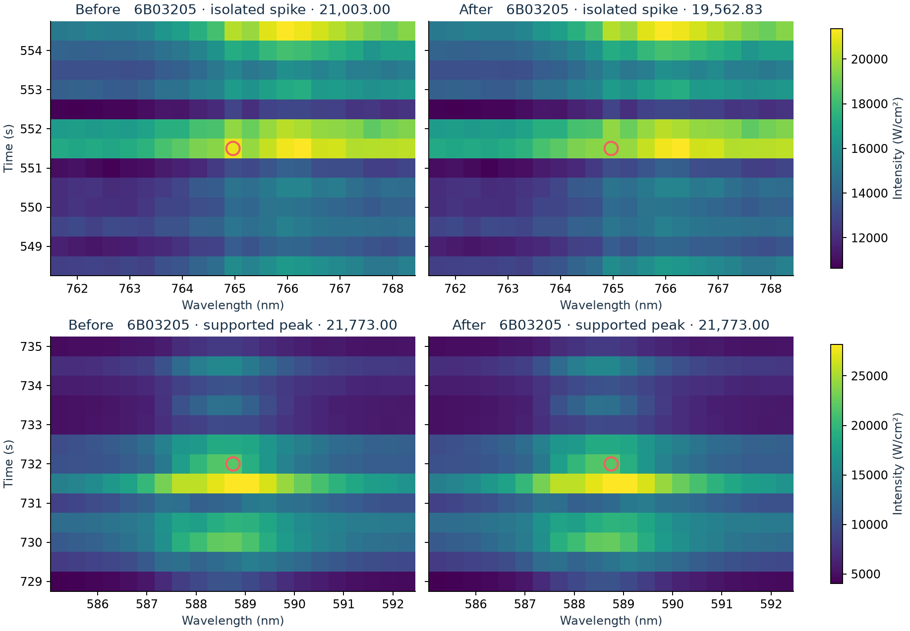
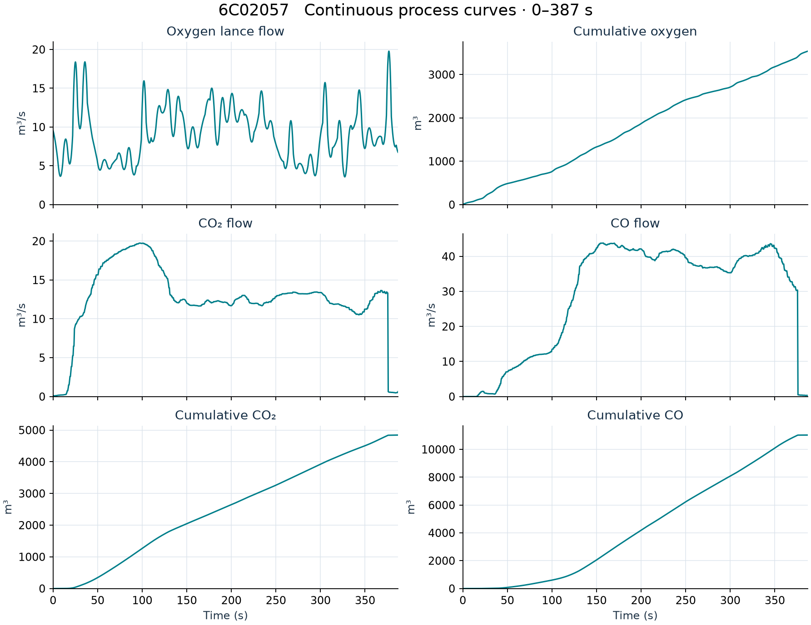

# Reconstructing Converter Flame Spectra and Forecasting Delayed Flue-Gas Measurements

## Summary

Flame spectra and flue-gas measurements describe the same steelmaking process on different time scales. We used records from ten converter heats to reconstruct the observed signals, examine the delay between oxygen supply and gas response, and test whether spectra could forecast gas measurements in a previously unseen heat.

We screened isolated spectral observations against their neighbours in time and wavelength and reconstructed the surface on each heat's native wavelength grid. Across 10,000 withheld interior observations that passed quality screening, the pooled mean absolute error (MAE) was 100.05 W/cm² and the root mean squared error was 153.22 W/cm². For offline process analysis, we reconstructed cumulative oxygen consumption with a monotone piecewise cubic curve and obtained oxygen flow from its derivative. Replacing the original flow estimate shifted the location of 80 of 90 candidate correlation peaks across heat, gas and process groups. The inferred delays therefore depend on the flow reconstruction; the available records do not independently identify gas transport time.

For prediction, we used only measurements available when issuing each forecast. We produced predictions for all ten heats and evaluated nine by leave-one-heat-out validation. One heat had two all-zero gas records that disagreed with the problem's example and was retained for prediction without quantitative scoring. For forecasts issued 10 seconds in advance and scored from 10 seconds after the start of each heat, adding spectral history reduced the heat-averaged CO MAE from 13.62 to 12.48 m³/s. The corresponding CO₂ error rose from 3.99 to 4.04 m³/s. In a paired comparison scored from 30 seconds, a model using oxygen-supply and process history achieved MAEs of 4.935 m³/s for CO and 2.685 m³/s for CO₂. Adding spectral features raised these errors to 5.408 and 3.053 m³/s. Thus spectral history improved CO forecasts when only spectra were available, while oxygen-supply history provided the stronger baseline when process measurements were available.

**Keywords:** converter steelmaking, spectral reconstruction, flue gas, time delay, leave-one-heat-out validation

## Contents

1. Observations and study design
2. Reconstructing the flame spectrum
3. Reconstructing oxygen supply and estimating gas delay
4. Predicting gas readings in an unseen heat
5. Conclusions
6. Appendix: heat-level results and figures

## 1. Observations and study design

A flame spectrum is available at the converter mouth before the corresponding flue gas can reach the analyzer. Both instruments report at the nominal interval of 0.5 s. This makes the forecasting question precise: given measurements through time t, what analyzer reading can be predicted at t + 10 s in a heat whose gas labels have never been used for training? The forecast horizon is fixed by the evaluation design. The physical transport delay must be assessed separately.

Each attachment supplies a sequence number, 2,047 spectral channels, cumulative oxygen volume and two gas measurements. We assign time zero to the first sample. The four B-series heats cover 340.535–1027.963 nm and the six C-series heats cover 339.390–1023.303 nm. We retain the native axes for reconstruction and use common physical wavelengths for prediction. The gas columns are labelled concentration in the files; we follow the problem's definition of instantaneous volumetric flow in m³/s. Integrating these values gives volume in m³.

Heat 6B03205 contains 1,479 consecutive pairs of zero gas readings. At sequence 500, its cumulative oxygen volume (998.97 m³) and displayed spectral values agree with the problem example, but the recorded gas readings differ. We retain the original records, reconstruct its spectrum and issue blind forecasts. Only the other nine heats contribute gas errors and delay estimates. Heat 6C02057 spans 387 s under the nominal sampling interval. Its timestamps cannot be independently verified, so it retains its original duration throughout the analysis.

## 2. Reconstructing the flame spectrum

At each interior point we compare intensity with its four nearest neighbours along the time and wavelength axes. A candidate impulse must lie outside the neighbouring range and differ from the neighbour median by more than max(1000, 8 × 1.4826 × MAD), where MAD is the median absolute deviation of the neighbours. We exclude clipped observations from the donor set. A flagged point is interpolated between valid bracketing wavelengths in its own frame, using their measured wavelength coordinates. Where that bracket is unavailable, we seek a temporal bracket in the same channel. The offline screen uses the next frame and is reserved for reconstruction.

The screen repaired 47 points across the ten heats. Figure 1 shows why local structure matters. At 551.5 s and 764.966 nm in 6B03205, the observed intensity of 21,003 exceeded the neighbouring maximum of 19,676; the same-frame estimate was 19,562.83 W/cm². A peak of 21,773 W/cm² at 732.0 s and 588.751 nm had support in adjacent measurements and was retained. Eight heats reached the recorded ceiling of 65,535. True intensities above that ceiling remain unknown.

*Figure 1. Local spectral intensity before and after screening in heat 6B03205. Each pair uses common coordinates and a common colour scale.*

Between consecutive time and wavelength nodes, the reconstructed intensity is the weighted sum of four corner values with weights (1−a)(1−b), (1−a)b, a(1−b) and ab. Here a and b are the fractional positions along time and wavelength. Each surface retains all native nodes; a 121 by 181 display grid keeps the ten figures comparable. Peak heights should be read on the native grid.

For validation, we held out 1,000 screened interior observations per heat using seed 20261126. A row-and-column spacing rule kept held-out points apart. The reconstruction was repeated after masking these values, with the test observations excluded as donors. The pooled errors over 10,000 points were 100.05 W/cm² (MAE) and 153.22 W/cm² (RMSE). These errors quantify interpolation of isolated, otherwise ordinary observations. Extended gaps and true heights of clipped peaks remain untested.

## 3. Reconstructing oxygen supply and estimating gas delay

We screened oxygen and gas records for negative or nonfinite values. A gas impulse was eligible for repair when both neighbouring readings agreed within 0.2 m³/s and the centre differed from both by at least 3 m³/s in the same direction. The screening rules yielded no eligible replacements in the three process series. Repeated cumulative oxygen readings followed by increments made single-step flow estimates sensitive to the recording pattern.

We anchored a monotone piecewise cubic Hermite curve to cumulative oxygen readings at 5.5 s intervals and both endpoints. Its derivative gives the offline lance flow estimate. In 6C02057 the maximum raw single-step flow was 109.82 m³/s; the reconstructed peak on the 0.1 s display grid was 19.78 m³/s. Integrating the quadratic derivative over each segment recovered the observed end-to-start oxygen change to within 4.55 × 10⁻¹³ m³ across heats. Trapezoidal integration on the display grid gave a maximum absolute discrepancy of 0.0398 m³. These checks establish volume closure; independent instantaneous flow measurements were unavailable.

We joined successive gas observations linearly and accumulated their trapezoidal areas from zero at the first observation. In 6B03270 the correlations of cumulative oxygen with instantaneous CO₂ and CO were −0.020 and 0.930, respectively. With cumulative CO₂ and CO volumes they were 0.993 and 0.967. Shared growth over time contributes to the latter correlations, limiting their use as evidence of reaction efficiency.

*Figure 2. Reconstructed oxygen supply, gas measurements and cumulative gas volumes for the shortest heat. The appendix provides the same six signals for every heat.*

For candidate delay estimation we compared 5 s changes in smoothed flow with later gas changes, scanning 0–40 s in 0.5 s steps and maximizing the absolute Pearson correlation. We grouped observations using source-time flow terciles and examined process halves and alternative smoothing windows. With the original trailing flow estimate, the high-flow CO₂ delay was shorter in seven heats and longer in two. For CO it was shorter in three, tied in one and longer in five. Repeating the scan using the reconstructed flow moved 80 of 90 candidate peaks. High-flow delays then became shorter in eight heats for CO₂ and one for CO. The direction of the association depends on the gas, and the inferred number of seconds depends strongly on signal processing.

## 4. Predicting gas readings in an unseen heat

We forecast each held-out heat using the other labelled heats. Forecast inputs use current and past observations only. In each frame we integrate spectral intensity in 16 bands over 341–1023 nm. The spectral history model adds trailing changes and smoothed spectral information. Process history includes elapsed time, cumulative oxygen, backward flow estimates and features for process progression. Ridge models are standardized using their training heats. The joint ensemble combines static fusion, historical fusion and lag-augmented historical fusion; weights are chosen separately for each gas by an inner leave-one-heat-out evaluation.

Table 1 uses common target times starting at 10 s for both concurrent and advance predictions. Errors are computed within each heat and then averaged equally across the nine labelled heats.

| Model | Concurrent CO₂ | Concurrent CO | 10 s ahead CO₂ | 10 s ahead CO |
|---|---:|---:|---:|---:|
| Training mean | 3.95 | 16.58 | 3.95 | 16.58 |
| Current spectrum | 4.04 | 13.73 | 3.99 | 13.62 |
| Spectral history | 4.20 | 12.60 | 4.04 | 12.48 |
| Process history | 2.70 | 4.76 | 2.67 | 4.77 |
| Joint ensemble | 3.11 | 5.21 | 3.19 | 5.24 |

*Table 1. Heat-averaged MAE in m³/s. All columns score the same analyzer target timestamps within each heat.*

Spectral history lowered 10 s ahead CO error by 1.14 m³/s. CO₂ exhibited a small increase. The joint ensemble struggled on the short heat 6C02057, with CO₂ MAE of 8.99 m³/s. This heat remains in the reported average.

*Figure 3. Analyzer readings and 10 s ahead forecasts across heats. The all-zero record for 6B03205 is ineligible for quantitative validation.*

A separate paired experiment scored 11,570 heat–time combinations from 30 s onward to allow history features to warm up. Holding the regression penalty, training weights and targets fixed, adding spectral features raised process-history MAE from 4.935 to 5.408 m³/s for CO and from 2.685 to 3.053 m³/s for CO₂. Interpolating interior clipped channels using their neighbours within the same frame changed every heat-level gas MAE by less than 0.0003 m³/s.

For the delay test, only candidate offsets supported by at least two training heats were eligible. When an estimated offset exceeded the 10 s forecast horizon, we added the spectral change between forecast issuance and the earlier candidate source time. CO never satisfied the support rule. CO₂ triggered the adjustment in seven folds, all based on the same two supporting heats. Its macro MAE rose from 3.053 to 3.101 m³/s. The delay rule therefore yielded no average gain under this evaluation.

## 5. Conclusions

A short spectral history helped forecast CO in an unseen heat when the furnace-mouth spectrum was the only input. The same benefit did not extend to CO₂. When oxygen-supply records were available, process history gave lower average errors and the tested spectral features added no average benefit. These findings concern the delayed analyzer readings of nine evaluable heats. Broader claims about new plants, clipped peak heights or the composition inside the bath require observations beyond this dataset.

## 6. Appendix: heat-level results and figures

Table A1 links each native-grid reconstruction and six-panel process figure to its heat-specific holdout errors. Intensities follow the units stated in the problem.

| Heat | Held-out points | MAE (W/cm²) | RMSE (W/cm²) | Spectrum | Process |
|---|---:|---:|---:|---|---|
| 6B03205 | 1000 | 65.89 | 96.90 | [Surface](../q1_q2/results/spectra/6B03205.png) | [Six signals](../q1_q2/results/process/6B03205.png) |
| 6B03206 | 1000 | 96.09 | 141.25 | [Surface](../q1_q2/results/spectra/6B03206.png) | [Six signals](../q1_q2/results/process/6B03206.png) |
| 6B03270 | 1000 | 78.16 | 117.31 | [Surface](../q1_q2/results/spectra/6B03270.png) | [Six signals](../q1_q2/results/process/6B03270.png) |
| 6B03271 | 1000 | 84.98 | 127.73 | [Surface](../q1_q2/results/spectra/6B03271.png) | [Six signals](../q1_q2/results/process/6B03271.png) |
| 6C02057 | 1000 | 119.18 | 181.19 | [Surface](../q1_q2/results/spectra/6C02057.png) | [Six signals](../q1_q2/results/process/6C02057.png) |
| 6C02058 | 1000 | 92.89 | 148.91 | [Surface](../q1_q2/results/spectra/6C02058.png) | [Six signals](../q1_q2/results/process/6C02058.png) |
| 6C02059 | 1000 | 112.13 | 168.77 | [Surface](../q1_q2/results/spectra/6C02059.png) | [Six signals](../q1_q2/results/process/6C02059.png) |
| 6C02060 | 1000 | 111.77 | 167.08 | [Surface](../q1_q2/results/spectra/6C02060.png) | [Six signals](../q1_q2/results/process/6C02060.png) |
| 6C02107 | 1000 | 116.96 | 176.16 | [Surface](../q1_q2/results/spectra/6C02107.png) | [Six signals](../q1_q2/results/process/6C02107.png) |
| 6C02108 | 1000 | 122.45 | 181.41 | [Surface](../q1_q2/results/spectra/6C02108.png) | [Six signals](../q1_q2/results/process/6C02108.png) |

Table A2 gives candidate delays (seconds) for the low and high flow groups using the reconstructed flow. Positive offsets place the analyzer response later than its source. A peak at 40 s reaches the search boundary.

| Heat | CO₂ low | CO₂ high | CO low | CO high |
|---|---:|---:|---:|---:|
| 6B03206 | 40.0 | 29.5 | 1.5 | 29.5 |
| 6B03270 | 40.0 | 0.0 | 0.0 | 40.0 |
| 6B03271 | 40.0 | 39.5 | 31.5 | 36.0 |
| 6C02057 | 39.0 | 4.0 | 40.0 | 30.0 |
| 6C02058 | 40.0 | 7.5 | 1.5 | 2.0 |
| 6C02059 | 0.0 | 5.0 | 0.0 | 5.0 |
| 6C02060 | 40.0 | 2.0 | 0.0 | 0.0 |
| 6C02107 | 40.0 | 7.5 | 0.0 | 0.0 |
| 6C02108 | 36.0 | 14.0 | 22.0 | 28.0 |
