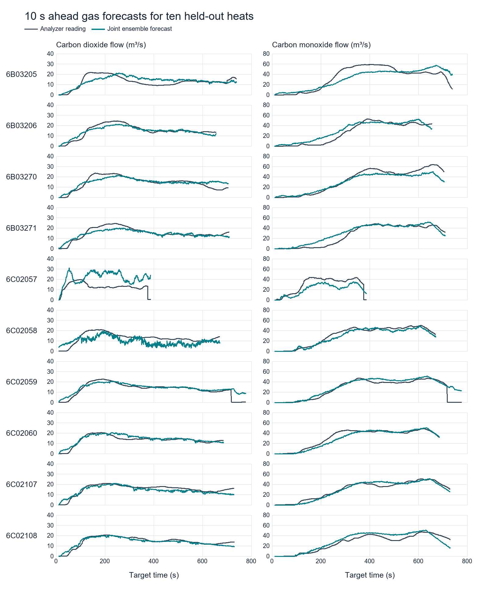

# 第三问 火焰光谱与供氧过程的烟气预测

> 历史初稿。此页记录附件修订前的九炉实验。最新十炉结果见 [英文稿](../paper/manuscript-en.md)。

以烟气分析仪的 CO₂ 和 CO 体积流量读数为目标，构建同刻估计和提前 10 s 的预测。十轮留炉实验覆盖全部附件，其中九炉有可用的烟气标签。提前 10 s 时，联合模型的分炉平均绝对误差分别为 3.19 和 5.24 m³/s。历史光谱单独使用时能改善 CO 预测，但在已加入供氧和工艺历史的模型中，未观察到稳定的光谱增益。

## 连续信号与可用信息

设预测发起时刻为 $t$，提前量为 $h$，分别估计分析仪在 $u=t+h$ 的 CO₂ 和 CO。两组实验取完全相同的目标时刻 $u=10,10.5,ldots$ s，直至各炉记录结束。特征仅使用发起时刻和此前的火焰光谱、累计供氧及已过时间。历史不足时，以该炉首个观测作左端延拓。同刻模型的标签仍是延迟测得的分析仪值，提前 10 s 的误差则衡量对未来分析仪读数的预报。

以第一问的实际波长对齐和异常标记为基础，在每个已观测时刻沿波长分段线性重构光谱。非有限值和负强度由同一时刻的有效波长邻点插值，65535 读数保留，并记录当时触顶比例。在两套仪器的共同范围 341–1023 nm 内，按 16 个等宽波段对连续光谱积分并除以带宽。高级光谱特征包括当前波段均值的 $\log(1+x)$、后向 11 点均值、10 s 变化量和触顶比例。

累计氧在相邻观测间作线性重构。在预测网格上，供氧流量用只依赖已观测端点的后向斜率表示。过程基线包含已过时间、累计氧和后向 5.5 s 斜率。过程历史模型增加后向 20.5 s 斜率、5.5 s 斜率的 10 s 变化量，以及每 120 s 和每 500 m³ 设置的分段线性基。时间基设在 120–600 s，氧量基设在 500–3000 m³。

## 时间对齐与模型组合

第二问的双向相关扫描取流量与烟气的 5 s 变化量。用 5.5 s 矩形核和三角核分别估计候选峰，两峰均须落在 $(0,40)$ s，时间差不超过 5 s，相关系数同号且绝对值均至少为 0.10。先平均同炉两峰，再取训练炉中位数并取整至 0.5 s 网格。每种气体至少要有两炉通过筛选，否则使用未加时延特征的历史融合模型。

设训练炉候选时延为 $\tau$。若 $\tau>h$，在当前及历史光谱特征之外加入 $u-\tau$ 与 $t$ 的对数波段均值之差，便于检验先前火焰状态对目标读数的解释力。在 $u-\tau$ 早于首个观测的情况下用首个观测。若 $\tau\le h$，沿用同一历史融合预测。该筛选得到的是记录之间的候选偏移。仪表响应、反应动力学与管道输运均可贡献该偏移。

比较训练炉均值、仅过程、仅光谱和过程与光谱融合模型。回归采用带截距的岭回归，标准化参数由训练炉估计，训练中每炉总权重相同。静态模型的岭惩罚为 10，历史与时延模型为 100。各模型输出截断至非负。

联合组合模型的候选包括静态融合、历史融合和加入候选时延的历史融合。对每个提前量及气体，在外层训练炉内再逐炉留出，根据各内折的炉均 MAE 选择单模型或两个模型的凸组合。两模型的权重各以 0.25 为步长取值。确定权重后，使用全部外层训练炉重新拟合候选模型，再预测外层测试炉。另设自适应组合，将单模态和常数模型也纳入候选，用于衡量允许退回更简单模型时的表现。外层测试炉仅用于最终评估。

## 十炉留出验证

6B03205 的两列烟气全程为零，且题面示例对应行给出了非零烟气值。该炉留出时以其余九炉训练，并输出 1459 个目标时刻的预测。其烟气列未参与监督训练、权重选择或误差计算。其余九轮各用八炉训练。先求每炉 MAE，再等权汇总。表中误差单位为 m³/s。

| 模型 | 同刻 CO₂ | 同刻 CO | 提前 10 s CO₂ | 提前 10 s CO |
| --- | ---: | ---: | ---: | ---: |
| 训练炉均值 | 3.95 | 16.58 | 3.95 | 16.58 |
| 仅过程基线 | 4.38 | 8.29 | 4.26 | 8.20 |
| 仅光谱基线 | 4.04 | 13.73 | 3.99 | 13.62 |
| 过程历史 | 2.70 | 4.76 | 2.67 | 4.77 |
| 光谱历史 | 4.20 | 12.60 | 4.04 | 12.48 |
| 历史融合 | 3.05 | 5.21 | 3.00 | 5.24 |
| 历史融合加时延 | 3.08 | 5.21 | 3.05 | 5.24 |
| 联合组合 | 3.11 | 5.21 | 3.19 | 5.24 |
| 自适应组合 | 3.00 | 4.92 | 3.05 | 4.84 |

| 测试炉 | 每个提前量的预测点数 | 同刻 CO₂ | 同刻 CO | 提前 10 s CO₂ | 提前 10 s CO |
| --- | ---: | ---: | ---: | ---: | ---: |
| 6B03205 | 1459 | — | — | — | — |
| 6B03206 | 1291 | 2.02 | 6.02 | 2.45 | 6.04 |
| 6B03270 | 1393 | 2.51 | 6.79 | 2.51 | 6.92 |
| 6B03271 | 1400 | 2.19 | 4.50 | 2.15 | 4.54 |
| 6C02057 | 755 | 8.95 | 8.43 | 8.99 | 9.58 |
| 6C02058 | 1323 | 4.94 | 4.35 | 4.93 | 3.71 |
| 6C02059 | 1535 | 2.20 | 5.51 | 2.44 | 5.20 |
| 6C02060 | 1353 | 1.97 | 3.72 | 1.82 | 3.74 |
| 6C02107 | 1439 | 1.95 | 2.94 | 1.92 | 2.77 |
| 6C02108 | 1441 | 1.27 | 4.59 | 1.54 | 4.64 |

提前 10 s 的仅光谱 CO 模型加入历史特征后，宏 MAE 从 13.62 降至 12.48 m³/s，九炉中八炉改善。对逐炉 MAE 差作 10000 次配对炉次重采样，得到误差差值的 95% 百分位区间为 −1.89 至 −0.40 m³/s。联合组合相对过程历史模型的提前 10 s 宏 MAE 则增加 0.47 m³/s（CO）和 0.53 m³/s（CO₂）。这说明本批数据中光谱本身带有可用的 CO 信息，过程历史已解释了更多跨炉变异。

候选时延筛选下，CO 整批只有一炉通过，因此各轮均沿用未加时延的历史融合模型。CO₂ 有两炉通过，两炉都在训练集时取 32 s。增加该对齐特征后，CO₂ 的提前 10 s 宏 MAE 从 3.00 变为 3.05 m³/s，逐炉差值的重采样区间为 −0.02 至 0.17 m³/s。该实验对稳定预测增益的支持有限，且只有九个可评分炉次，重采样区间用于描述这批炉次的敏感性。

短炉 6C02057 的联合模型提前 10 s CO₂ MAE 为 8.99 m³/s，$R^2=-5.79$，是跨炉预测的主要失败案例。其记录只有 387 s，平均供氧约为 9.14 m³/s，其余炉约为 4.59–5.07 m³/s。该差异提示交付数据涵盖的工艺条件对泛化有影响。随着新炉、有明确时基的短炉和独立延迟测量加入，才能进一步检验跨工况预测和时延解释。
